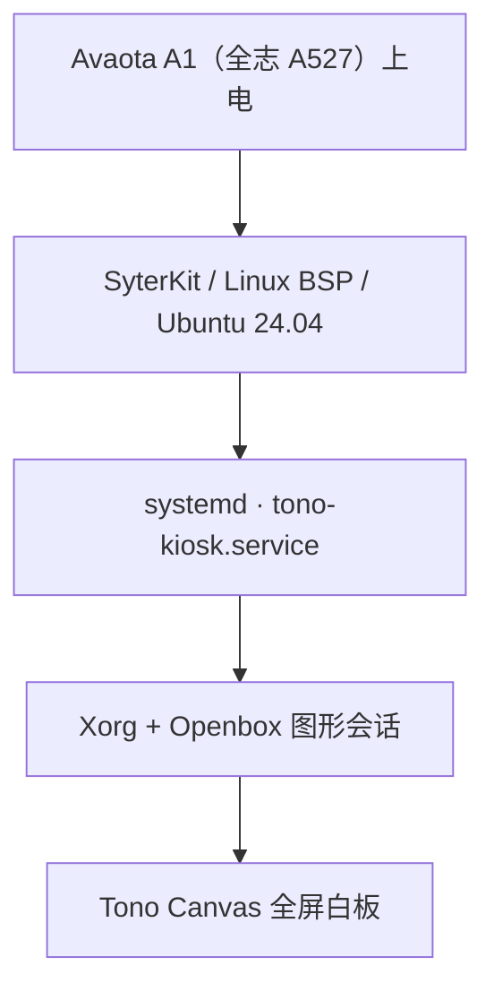

# AvaotaOS · 单应用画板基础系统

面向搭载 **全志（Allwinner）A527** 的 **Avaota A1 开发板**，为 Tono Canvas 提供专用 Linux 基础系统。设备上电后自动进入全屏白板，提供手写、HTML/WebGL 内容、中文输入、网络和音视频所需的运行环境。

本仓库负责构建完整的 TF / SD 卡启动镜像，以及白板的启动、停止和系统维护。白板 App 在独立的 [Tono Canvas App 仓库](https://github.com/TonoTeam/tono-canvas-app) 开发，通过 ARM64 `.deb` 安装到镜像中；AI 服务端独立部署，地址在 App 中配置。

## DeepSeek Harness 浏览器入口

本开发分支另提供 [DeepSeek Harness 开机浏览器模式](doc/deepseek-harness.md)。在现有 A527 系统安装离线包并启用后，设备上电直接进入本机 Harness，替代白板启动入口；支持自动认证和服务重启恢复。浏览器保留返回、前进和关闭标签页入口。已在 Buildroot A527 实机部署并验证系统重启自动进入；首次使用需登录模型账号或配置 API Key。下面保留原画板系统的构建与维护说明。

## 项目定位

系统围绕一个白板应用配置，使用 `kiosk` 镜像类型：

- **开机进入白板**：由 systemd 启动图形会话和全屏 App，异常退出后自动重启。
- **精简运行环境**：保留 Xorg / Openbox 管理窗口与弹窗焦点，省去 GNOME、登录管理器、桌面面板和桌面应用。
- **保留画板功能**：提供 Qt Quick、WebEngine、Mesa、中文字体、拼音输入、音频和摄像头的运行依赖；具体功能由所安装的 App 提供，外设需实机验证。
- **图形加速与回退**：自动探测 Mali-G57 / Panfrost 的 GLES 能力，选择硬件加速或软件恢复模式；App 以普通用户运行，保留 Chromium 沙盒。
- **保留设备维护入口**：网络、SSH、apt、USB、日志和串口继续可用，Wi-Fi 可通过 App 的设置页面配置。
- **独立更新 App**：通过 `.deb` 升级白板，沿用现有用户、画板、设置和设备身份，无需为每次 App 更新重刷系统。

## 系统架构



当前单应用配置的支持范围：

| 项目 | 配置 |
| --- | --- |
| 开发板 | Avaota A1 |
| 主控芯片（SoC） | 全志（Allwinner）A527 |
| 系统 | Ubuntu 24.04，代号 `noble` |
| 架构 | ARM64，由板级配置确定 |
| 内核与启动器 | 板载外设所需的 BSP、设备树、固件与 SyterKit |
| 图形环境 | X11 / Xorg、Openbox、Qt Quick / QML、Qt WebEngine |
| 应用包 | `tono-canvas`，ARM64，版本不低于 1.1.5 |

仓库仍保留上游的其他系统与桌面构建入口；画板设备使用本文的 `kiosk` 配置。

另提供 [Buildroot 单应用版本](doc/buildroot.md)，使用独立的 `build_buildroot.sh` 入口。首版由 Buildroot 构建系统核心、网络和音频服务，并保留已验证的 Qt/WebEngine 图形兼容运行时。

## 快速构建

### 1. 准备应用安装包

在 **Ubuntu 24.04 ARM64** 环境中构建 Tono Canvas App，按其 [Linux 移植说明](https://github.com/TonoTeam/tono-canvas-app/blob/main/docs/linux-port.md) 安装依赖，再使用 CMake / CPack 生成 `.deb`。安装前缀使用 `/usr`。

镜像构建器接收已经构建好的应用包，不在目标设备上编译 App。应用包必须为 `tono-canvas`、架构为 `arm64`，且支持 `--opengl-es`；不能使用 x86_64 包。

### 2. 构建完整镜像

推荐在 Ubuntu 24.04 Linux 构建机执行。构建需要 sudo、loop 设备和挂载能力；macOS 可通过具备这些能力的 Linux 虚拟机或容器构建，普通非特权容器不足以打包完整镜像。

```sh
git clone --depth=1 https://github.com/TonoTeam/AvaotaOS.git
cd AvaotaOS

sudo bash build_all.sh \
  -b avaota-a1 -v noble -t kiosk \
  --app-deb /absolute/path/to/tono-canvas_VERSION_arm64.deb \
  -k no -g bsp -l no -i no -o no -e no
```

将 `--app-deb` 替换为本次要集成的应用包路径。构建会安装该包及其运行依赖，即使复用基础系统缓存，也会安装本次指定的 App。

构建产物位于 `build_dir/`：

```text
build_dir/sdcard.img
build_dir/AvaotaOS-<版本>-noble-kiosk-arm64-avaota-a1.img.xz
```

常用构建选项：

| 选项 | 用途 |
| --- | --- |
| `-b avaota-a1 -v noble -t kiosk` | 选择 A1 的 Ubuntu 24.04 单应用配置 |
| `--app-deb <文件路径>` | 指定要安装的 ARM64 白板包，构建完整 kiosk 镜像时必填 |
| `-g bsp -k no` | 使用 BSP 内核，不打开内核配置界面 |
| `-m <镜像源地址>` | 指定系统软件包镜像源 |
| `-u <用户> -p <用户密码> -s <root密码>` | 设置系统账户 |
| `-l no` | 获取内核与启动器源码；首次构建使用此值 |
| `-l yes` | 使用已经准备好的本地内核与启动器源码 |
| `-o no` | 构建完整镜像；`yes` 仅构建内核包 |
| `-e yes` | 启用 ccache |

基础系统缓存、镜像容量计算、依赖保留和完整验证流程见 [单应用镜像构建与维护](doc/kiosk.md)。镜像发布入口为 [Releases](https://github.com/TonoTeam/AvaotaOS/releases)。

## 烧录与首次启动

1. 将完整 `.img` 写入 TF / SD 卡；使用 `.img.xz` 时先解压，或使用支持 XZ 的镜像烧录工具。烧录会覆盖目标卡，先备份已有内容。
2. 将卡插入 Avaota A1，连接显示器、输入设备并上电。首次启动会将根分区扩展到卡的可用容量，初始化时间会比后续启动长。
3. 系统自动进入 Tono Canvas 全屏首页。在 **首页 → 设置 → Wi-Fi** 配置无线网络，或连接有线网络。
4. 在 App 设置中填写 AI 服务地址。本地画板不等待服务器连通即可使用，AI 对话功能需要可用的服务端。

根文件系统位于卡上，运行中保持插卡。通过 `sudo poweroff` 正常关机，待系统停止后再断电，让 App 完成保存和文件系统同步。

未指定自定义账户时，构建器使用以下开发默认值；部署后请修改默认密码：

| 用户 | 默认密码 |
| --- | --- |
| `avaota` | `avaota` |
| `root` | `avaota` |

## 维护与更新

使用普通用户连接设备，将 `DEVICE_IP` 替换为实际设备地址；自定义用户时替换 `avaota`：

```sh
ssh avaota@DEVICE_IP
```

查看应用会话和本次启动日志：

```sh
systemctl status tono-kiosk.service
journalctl -b -u tono-kiosk.service -n 100 --no-pager
journalctl -b -t tono-kiosk-start -n 100 --no-pager
```

更新 App 前备份最新画板与设置，再正常停止会话并安装应用包：

```sh
sudo systemctl stop tono-kiosk.service
sudo apt install ./tono-canvas_VERSION_arm64.deb
sudo sync
sudo systemctl start tono-kiosk.service
```

正常停止会触发 App 的保存关闭流程，图形会话会等待保存完成。保留默认 XDG 数据与配置目录，不覆盖已有画板、服务器地址或设备身份；保存失败时先检查日志并保留现场数据。完整镜像用于首次部署或系统重建，已有设备的日常 App 更新使用 `.deb`。

运行配置位于 `/etc/default/tono-kiosk`，可选择自动、硬件或软件渲染模式。配置方法、软件渲染恢复及黑屏排查见下方文档。

## 文档导航

| 文档 | 内容 |
| --- | --- |
| [单应用镜像构建与维护](doc/kiosk.md) | App 打包、完整镜像构建、缓存、启动、Wi-Fi、更新与验收 |
| [黑屏排查与系统文件恢复](doc/kiosk-recovery.md) | 启动故障定位、文件完整性检查与画板索引恢复 |
| [镜像体积与功能验证](doc/kiosk-size-validation.md) | 精简规则及对应构建的体积、空间和功能验证记录 |
| [Buildroot 构建与维护](doc/buildroot.md) | A527 Buildroot 系统核心、应用兼容运行时与完整镜像构建 |
| [DeepSeek Harness 浏览器模式](doc/deepseek-harness.md) | 离线安装、开机进入、浏览器导航、自动认证与回退 |
| [Buildroot 构建验证](doc/buildroot-validation.md) | 构建产物、软件回归及硬件验证范围 |
| [GPU 加速验证](doc/kiosk-gpu-validation.md) | GLES / WebGL、软件恢复模式及完整镜像验收 |

## 上游与许可

本项目基于 [AvaotaSBC/AvaotaOS](https://github.com/AvaotaSBC/AvaotaOS)，在其构建框架上维护 Tono Canvas 单应用系统集成。构建框架使用 [GPL-3.0](LICENSE)；镜像中各组件沿用各自的许可证。
